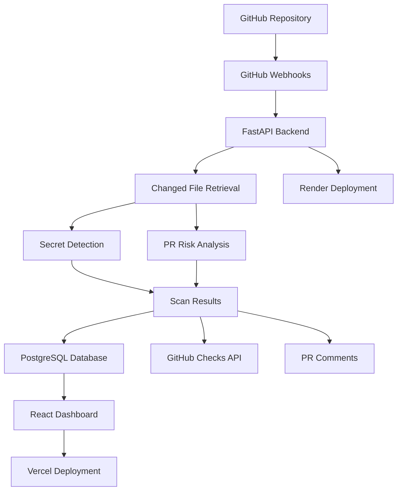

# 🛡️ GitGuard AI

### AI-Powered GitHub Secret Detection and Pull Request Risk Analysis

GitGuard AI is an intelligent GitHub security application that automatically scans code changes, detects exposed secrets, and evaluates pull request risks using Machine Learning.

It integrates with GitHub through webhooks and provides automated security feedback through GitHub Checks and pull request comments.

**Live Application:** https://git-guard-ai-six.vercel.app/

**Backend API:** https://gitguard-ai-fw9m.onrender.com

---
## 📸 Dashboard Preview

### Security Overview


### Recent Scan Activity


### GitHub Pull Request Security Scan

GitGuard AI automatically analyzes pull requests and posts security
feedback with secret detection and risk assessment results.


## 🚀 Features

### 1. Automated Secret Detection
- Detects potentially exposed API keys, tokens, passwords, and other sensitive credentials.
- Uses regex-based pattern matching.
- Uses Shannon entropy analysis to identify suspicious strings.
- Uses a Machine Learning model for secret classification.

### 2. AI-Based Pull Request Risk Analysis
- Automatically analyzes GitHub pull requests.
- Evaluates changes using a Random Forest classifier.
- Considers code changes and security-related features.
- Classifies pull requests based on their predicted risk.

### 3. GitHub Integration
- GitHub App authentication.
- Webhook integration for push and pull request events.
- Automatic scanning of changed files.
- GitHub Check Runs for security feedback.
- Automated pull request comments.

### 4. Security Dashboard
- Total scan statistics.
- Secret detection results.
- Pull request risk information.
- Recent scan history.
- Scan status and confidence scores.

### 5. Database Integration
- PostgreSQL database.
- Stores scan results and scan history.
- Provides data for the dashboard.

---

## 🧠 Machine Learning Models

GitGuard AI uses two Machine Learning models:

| Model | Purpose |
|---|---|
| Logistic Regression | Secret detection |
| Random Forest Classifier | Pull request risk prediction |

Additional techniques include:
- TF-IDF text vectorization.
- Regex-based secret detection.
- Shannon entropy calculation.
- Feature-based risk analysis.

---

## 🛠️ Technology Stack

### Frontend
- React.js
- Vite
- JavaScript
- CSS

### Backend
- Python
- FastAPI
- REST APIs

### Machine Learning
- Scikit-learn
- Pandas
- NumPy
- TF-IDF
- Logistic Regression
- Random Forest

### Database
- PostgreSQL
- SQLAlchemy

### Integration and Deployment
- GitHub Apps
- GitHub Webhooks
- GitHub Checks API
- Vercel
- Render

---

## ⚙️ System Architecture



---

## 🔄 How It Works

1. A developer pushes code or creates/updates a pull request.
2. GitHub sends a webhook event to the GitGuard AI backend.
3. The backend authenticates with the GitHub App.
4. GitGuard retrieves the changed files.
5. The secret detection system scans the changes.
6. The Machine Learning models analyze the relevant security features.
7. Scan results are stored in PostgreSQL.
8. GitHub Checks and pull request comments provide security feedback.
9. The dashboard displays scan statistics and results.

---

## 🌐 Live Deployment

| Component | Platform |
|---|---|
| Frontend | Vercel |
| Backend | Render |
| Database | PostgreSQL on Render |

**Live Dashboard:**  
https://git-guard-ai-six.vercel.app/

---

## 💻 Local Installation

### Prerequisites
- Python 3.12
- Node.js and npm
- Git
- PostgreSQL

### 1. Clone the Repository

```bash
git clone https://github.com/anamikaah05/GitGuard-AI.git
cd GitGuard-AI
```

### 2. Backend Setup

```bash
cd backend
python -m venv venv
```

Activate the virtual environment.

Windows:

```powershell
venv\Scripts\activate
```

Install dependencies:

```bash
pip install -r requirements.txt
```

Configure the required backend environment variables in a `.env` file. These include database connection details, GitHub App credentials, webhook configuration, and allowed frontend origins.

Start the backend:

```bash
uvicorn main:app --reload --port 8000
```

Backend API documentation:

http://127.0.0.1:8000/docs

### 3. Frontend Setup

Open another terminal:

```bash
cd frontend
npm install
```

Create a `.env` file in the frontend directory:

```env
VITE_API_URL=http://127.0.0.1:8000
```

Start the frontend:

```bash
npm run dev
```

Open:

http://localhost:5173

---

## 🔐 Security

- GitHub authentication uses a GitHub App.
- Webhook requests are validated using a configured webhook secret.
- Sensitive credentials should be stored in environment variables.
- Never commit private keys, API tokens, or database credentials to GitHub.

---

## 🔮 Future Improvements

- Advanced false-positive reduction.
- More comprehensive security vulnerability detection.
- Detailed scan reports and analytics.
- Repository-level security insights.
- Improved model performance and evaluation.
- Enhanced dashboard visualizations.

---

## 👩‍💻 Author

**Anamika R**

GitHub: https://github.com/anamikaah05

---

⭐ If you find this project interesting, consider giving the repository a star!
